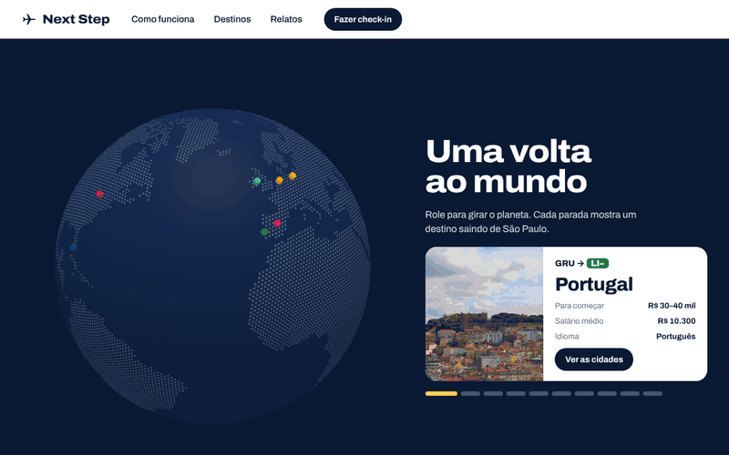
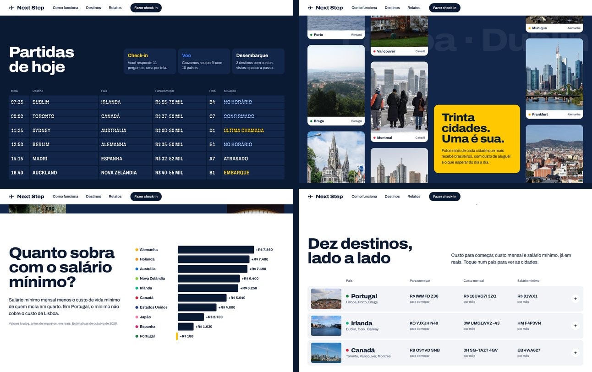
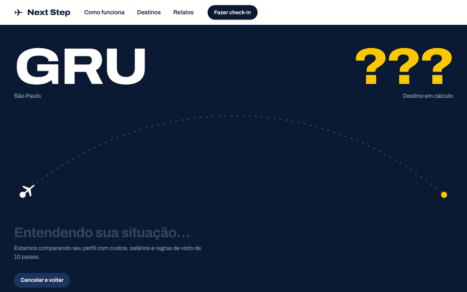
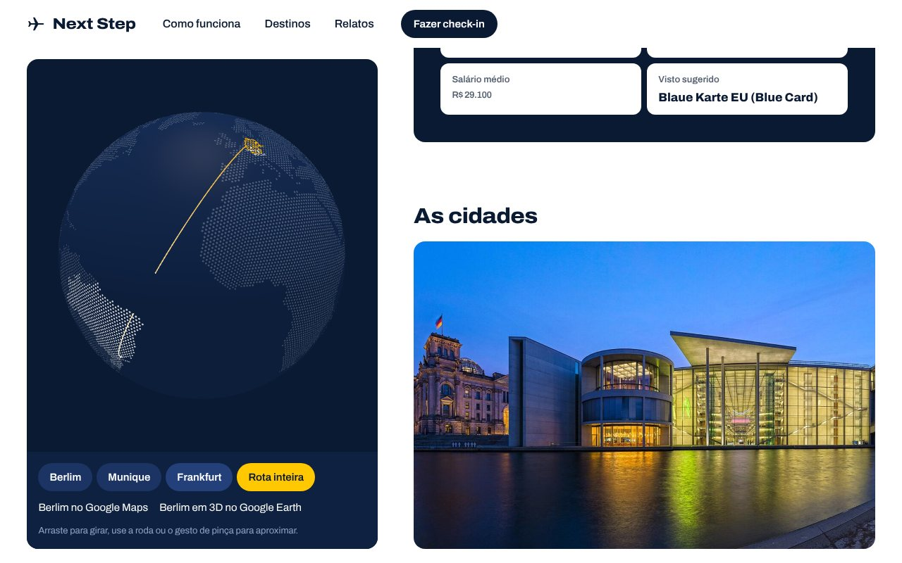
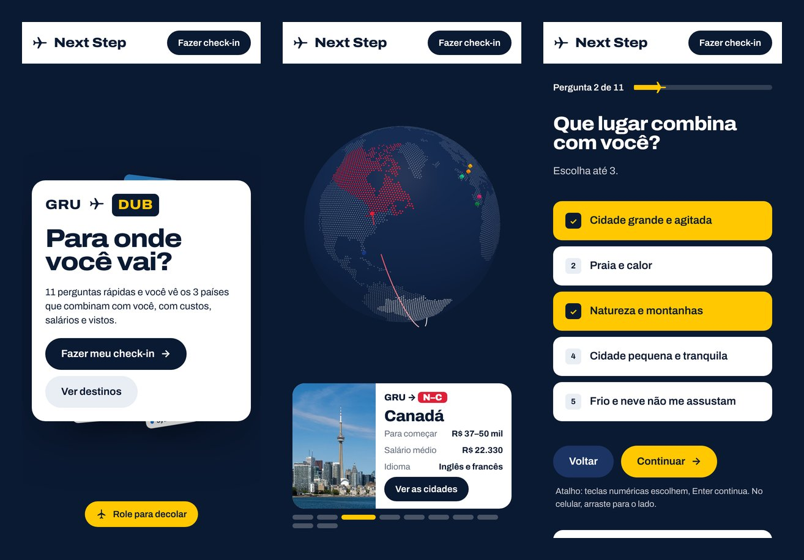

<p align="center">
  
</p>

<h3 align="center">Descubra para qual país ir: 11 perguntas, 3 destinos, tudo em reais.</h3>

<p align="center">
  <a href="#começar-rápido"></a>
  <a href="https://vercel.com/new"></a>
  <a href="#publicar"></a>
</p>

<p align="center">
  
  
  
  
  
  
  <br>
  
  
  
  
  
  
</p>

<p align="center">
  
</p>

## Por que o Next Step

- **Feito para quem sai do Brasil.** Custos, salários e vistos de 10 países que mais recebem brasileiros, já convertidos para reais.
- **Uma resposta, não uma lista.** O check-in cruza orçamento, idiomas, formação, idade, cidadanias e prioridades e devolve 3 destinos com o porquê.
- **Dados que dá para conferir.** Cada país traz agências e órgãos oficiais, relatos públicos de brasileiros com link para a fonte e um passo a passo.
- **Roda em qualquer lugar.** Site estático: publique no Vercel, Netlify ou GitHub Pages sem servidor nem chave de API.

## O que tem na página

<table>
  <tr>
    <td width="50%"></td>
    <td width="50%"></td>
  </tr>
  <tr>
    <td align="center"><b>O mundo te espera</b><br>A foto expande com a rolagem e os números sobem</td>
    <td align="center"><b>Uma volta ao mundo</b><br>O planeta gira e para em cada destino</td>
  </tr>
</table>

<p align="center">
  
</p>

| Seção | O que acontece |
| --- | --- |
| Túnel de fotos | 20 cidades voam em 3D ao redor do cartão de embarque conforme a rolagem; o código do destino troca como num painel de aeroporto. |
| Letreiro | Duas faixas em movimento com horários que mudam sozinhos; a velocidade acompanha a rolagem. |
| O mundo te espera | Foto em expansão com contadores (10 países, 30 cidades, 30 relatos, 40 vistos). |
| Uma volta ao mundo | Globo 3D com a rota saindo de São Paulo para cada país. |
| Partidas de hoje | Painel split-flap com os destinos, custo para começar e situação do voo. |
| Trinta cidades | Colunas de fotos em velocidades diferentes (parallax com GSAP). |
| Quanto sobra | Salário mínimo menos custo de vida mínimo, por país. |
| Dez destinos | Lista comparativa com as cidades de cada país. |
| Relatos | Depoimentos públicos de brasileiros, com arrastar para o lado. |

## Check-in e resultado

<table>
  <tr>
    <td width="50%"></td>
    <td width="50%"></td>
  </tr>
  <tr>
    <td align="center"><b>Check-in</b><br>Uma pergunta por tela, com swipe e o cartão de embarque se preenchendo</td>
    <td align="center"><b>Voo</b><br>O avião sai de Guarulhos e pousa no destino escolhido</td>
  </tr>
</table>

<p align="center">
  
</p>

Cada destino traz: fotos das cidades em carrossel, globo 3D com atalhos para Google Maps e Google Earth, orçamento comparado ao seu, salários de vagas comuns entre brasileiros, visto sugerido e outras rotas, agências e órgãos oficiais, relatos e o passo a passo.

<p align="center">
  
</p>

## No celular

<p align="center">
  
</p>

## Começar rápido

Requer **Node.js 20 ou mais novo** ([nodejs.org](https://nodejs.org)).

```bash
npm install
npm run dev
```

Abra http://localhost:3000.

> No Windows, se o PowerShell disser que a execução de scripts está desabilitada, use o Prompt de Comando (`cmd`) ou `npm.cmd install` / `npm.cmd run dev`.

O modo `dev` é mais lento por natureza. Para ver o site como ele fica publicado:

```bash
npm run build
npm run preview
```

## Scripts

| Comando | O que faz |
| --- | --- |
| `npm run dev` | Servidor de desenvolvimento com recarga automática |
| `npm run build` | Gera o site estático em `out/` |
| `npm run preview` | Serve `out/` em http://localhost:3000 |
| `npm run lint` | Checagem de tipos do TypeScript |

## Publicar

| Onde | Como |
| --- | --- |
| **Vercel** | [Importe o repositório](https://vercel.com/new). O build padrão já funciona. |
| **Netlify** | Build command `npm run build`, pasta de publicação `out`. |
| **GitHub Pages** | Em *Settings › Pages*, escolha *Source: GitHub Actions*. O workflow `.github/workflows/pages.yml` publica a cada push na `main` e ajusta os caminhos para `usuario.github.io/<repo>`. |

## Como funciona

```
 Página inicial ──► Check-in (11 perguntas) ──► Voo ──► Cartão de embarque
                          │                                   ▲
                          ▼                                   │
                 respostas no navegador            src/lib/scoring.ts
                 (localStorage)              orçamento · idioma · formação
                                             idade · cidadania · área
                                             prioridades  ──►  top 3 países
                                                                 │
                                         src/lib/data.ts ◄────────┘
                                 custos · salários · vistos · cidades
                                 agências · relatos · dicas (out/2026)
```

A recomendação é calculada no navegador, com regras explícitas em `src/lib/scoring.ts`. Não há chamada a IA nem chave de API.

## Estrutura

```
src/
  app/                 layout, página e globals.css (paleta + Tailwind)
  components/
    ui/                componentes no padrão shadcn
      button.tsx
      perspective-tunnel-hero.tsx   túnel de fotos (21st.dev, adaptado)
      scroll-expansion-hero.tsx     foto em expansão (21st.dev, adaptado)
      parallax-scrolling.tsx        parallax com GSAP (Osmo, adaptado)
    landing/           letreiro, planeta, painel, gráfico, destinos, relatos
    checkin/           check-in com swipe e animação de voo
    result/            cartão de embarque, globo 3D e detalhes do país
    shared/            split-flap, títulos animados, contadores, ícone
    providers.tsx      Lenis + GSAP e preferência de movimento do sistema
  lib/
    data.ts            base dos 10 países
    scoring.ts         regras do ranking
    questions.ts       perguntas do check-in
    geo.ts             contornos dos países e criação do globo
public/
  img/                 30 fotos (ver CREDITS.md)
  geo/                 world-atlas 110m
docs/                  imagens e GIFs deste README
```

**Por que `/components/ui`:** o shadcn/ui copia componentes para dentro do projeto em vez de instalá-los como pacote. A CLI (`npx shadcn@latest add ...`) usa o caminho definido em `components.json`. Manter esse padrão faz novos componentes do shadcn ou do 21st.dev caírem no lugar certo e importarem `cn` de `@/lib/utils` sem ajustes.

## Stack

| Biblioteca | Versão | Papel |
| --- | --- | --- |
| Next.js | 15.5 | App Router com exportação estática |
| React | 19.1 | Interface |
| TypeScript | 5.9 | Tipos |
| Tailwind CSS | 4.1 | Utilitários e tokens da paleta |
| Framer Motion | 12.23 | Rolagem ligada às animações, swipe, transições |
| GSAP + ScrollTrigger | 3.13 | Parallax da galeria |
| Lenis | 1.3 | Rolagem suave |
| globe.gl | 2.45 | Planeta e globo do resultado (Three.js) |
| topojson-client | 3.1 | Contornos dos países |

## Movimento e acessibilidade

As animações são automáticas. Se o sistema pede para reduzir movimento, o site mantém as animações e tira apenas os extras mais intensos: rolagem com inércia, fotos que seguem o mouse, confete e o giro do cartão no check-in. Todo controle funciona pelo teclado, e as perguntas aceitam atalhos numéricos.

## Dados

Valores aproximados, pesquisados em fontes públicas em outubro de 2026.

| Moeda | Câmbio de referência |
| --- | --- |
| Euro | €1 ≈ R$ 6,00 (PTAX 29/10/2026) |
| Dólar americano | US$1 ≈ R$ 5,00 |
| Dólar canadense | CA$1 ≈ R$ 3,85 |
| Dólar australiano | A$1 ≈ R$ 3,50 |
| Dólar neozelandês | NZ$1 ≈ R$ 2,85 |
| Iene | ¥100 ≈ R$ 3,20 |

São estimativas para planejar, não aconselhamento jurídico ou migratório. Confirme sempre nos órgãos oficiais de cada país.

## Créditos

- Fotos: Wikimedia Commons, cada uma com sua licença (CC0, CC BY ou CC BY-SA), listadas em [CREDITS.md](CREDITS.md). As versões recortadas seguem a licença original.
- Contornos dos países: [world-atlas](https://github.com/topojson/world-atlas) (Natural Earth).
- Componentes de referência: [21st.dev](https://21st.dev) (perspective-tunnel-hero, scroll-expansion-hero) e [Osmo](https://www.osmo.supply) (parallax-scrolling), adaptados.

## Licença

Defina a licença do código deste repositório (por exemplo, MIT). As fotos mantêm as licenças listadas em [CREDITS.md](CREDITS.md).
